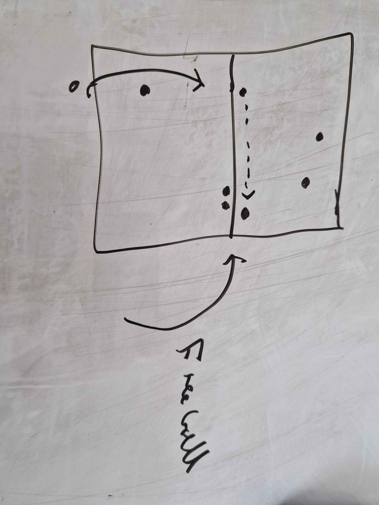
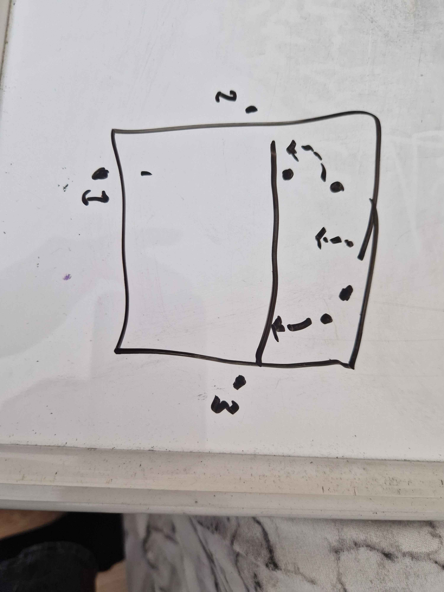

# Attacking opportunities

# Focus: Creating an attacking opportunity from service and a play around with out of system balls

# Resources
- 8+ players
- 10+ balls
- 1 coach
- 1:30 hour
- 1 court

# Warmup 1;
Using a dodgeball, warming up with arm throws and into how we use our core

I.E throwing off balance, throwing with our balance
throwing with a jump

# Warmup 2;

3 on one side at position 4 (in a queue), one of those becomes a passer and rotates, we rotate from passing to setting then setting to attacking, our setter is at position 2

Then there's a ball being fed in from the other side for a passer and a setter

We will replicate this on both sides working on creating that consistent footwork as well as ways to get to the ball for an attack

# Activity 1; Attacking from serve and freeballs

4 on one side and a server, passer and 2 blockers on the other

The attacking side can only attack at position 5 (cross court)

# Activity 2; serve into attack zone
Adding now 2 free balls and our attacker is adjusting to if it's coming from an out of system player or from our setter

There is now an attack on the right side, a pipe attack and a left side attack with a libero in the mix as well

# Gameplay