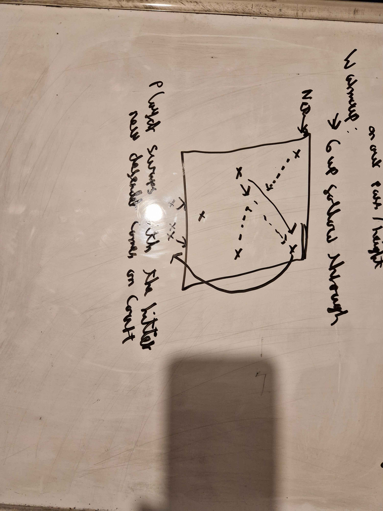
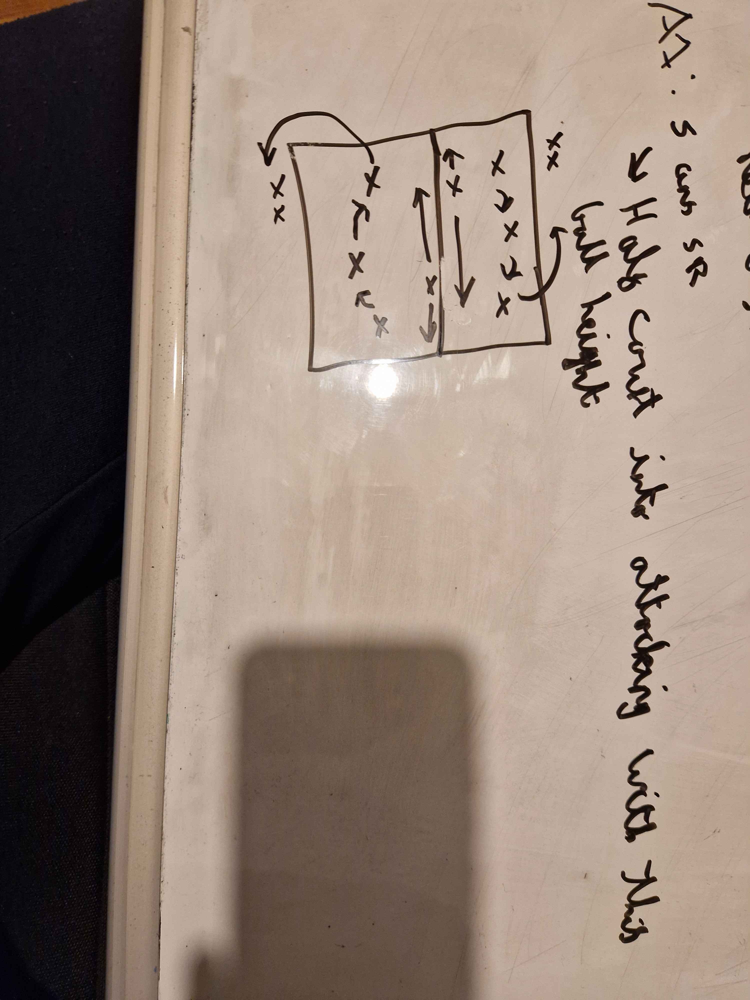

# Looking at tracking ball height as a hitter

# Focus: Can we recognise the height and flight of the set, adjust our approach and create a controlled attacking opportunity? When in system, can we consistently create a faster attacking tempo, achieving a good attacking opportunity 60% of the time?

Another note on this focus is that we are looking at the height and what we can do as attackers to give us the best opportunity. Something that I would like you to think of is how does the attack feel when the ball is a bit lower like this?

(My thoughts are that the ball is actually far easier to hit as long as I'm ready)

General notes;

2 weeks our from GP.. What I hope we know now? 5:1 system. Defensive systems, perim defence.. Serve and serve receive

Goal; to create some flow with our defence to set to attack In SR can we hold our pass to target?

# Resources
- 11+ players
- 10+ balls
- 1 coach
- 1:30 hour
- 1 court

# Videos

On this (yes I know it's who we think is the hitter), can we look at what the hitter does to get ready and the pace of the set, the ball is not going too much higher than the antenna and are quite low;

<iframe width="560" height="315" src="https://www.youtube.com/embed/qHoRnHk46BM?si=AO0pwVTTKww7bfoc&amp;start=144" title="YouTube video player" frameborder="0" allow="accelerometer; autoplay; clipboard-write; encrypted-media; gyroscope; picture-in-picture; web-share" referrerpolicy="strict-origin-when-cross-origin" allowfullscreen></iframe>

Lets take a look at this 2 ball set;

Hitters - what do you notice about the height of the set and where they are on the approach?
Setters - What do you notice about the height of the set?
<iframe width="560" height="315" src="https://www.youtube.com/embed/qHoRnHk46BM?si=sHEpfeOP9qTyS169&amp;start=1964" title="YouTube video player" frameborder="0" allow="accelerometer; autoplay; clipboard-write; encrypted-media; gyroscope; picture-in-picture; web-share" referrerpolicy="strict-origin-when-cross-origin" allowfullscreen></iframe>

Lets take a look at these 4 ball sets;
Hitters - what do you notice about the height of the set and where they are on the approach?
Setters - What do you notice about the height of the set?
<iframe width="560" height="315" src="https://www.youtube.com/embed/qHoRnHk46BM?si=6ZwgCgilr37DxSX-&amp;start=1850" title="YouTube video player" frameborder="0" allow="accelerometer; autoplay; clipboard-write; encrypted-media; gyroscope; picture-in-picture; web-share" referrerpolicy="strict-origin-when-cross-origin" allowfullscreen></iframe>

<iframe width="560" height="315" src="https://www.youtube.com/embed/qHoRnHk46BM?si=Z5d0ICE4q4JlE0Yc&amp;start=1922" title="YouTube video player" frameborder="0" allow="accelerometer; autoplay; clipboard-write; encrypted-media; gyroscope; picture-in-picture; web-share" referrerpolicy="strict-origin-when-cross-origin" allowfullscreen></iframe>

# Warmup;
A variation of 6 up see image; 

We are going to play an out of system game where the attacker hits and then rotates to the back, the player that sets up the out of system attack becomes the attacker and rotating through

On the other side we are going to look at some setting technique and ball heights how do we create consistency in both of these areas?

Starting with a thrown ball, into a bounced ball and working on the ball height for 4 (area) sets and 2 (area) sets 

# Activity 1; Slow and fast tempo
A setter, 2 attackers and a passer on one side

A feeder and someone to help feed, 3 in defence

Working on our L-R-L footwork with our attack and hand contact or even a R-L

Going to go for a few minutes the attackers swap each attack

Working with a tempo like system off of the setter, the middle should be jumping as the setter touches the ball

The outside should be starting their approach as the middle jumps

Cues; if we're the outside hitter are we on our left step as the setter goes to make contact?
Am you loading?

# Activity 2; S and SR
Building into this attacking height and opportunities (see image)

We are going to play a 4 game on and rotate in.

Our 4 player and 2 player are front court hitters.

Playing to games of 5

Affordances; 
1. Ball height nad passing height
2. Building from S and SR
3. Ball around antenna height
4. (3.1) What does this do for our attackers?

Cues; We are trying to keep the focus on the ball height and being ready as an attacker with that. 
What are our setters looking for? How can they create the best ball height and flight (with control) based on the pass they receive?

# Expanding out to our 6 vs 6
Keeping passing active on our service

Starting from 18-18

If we keep the ball height around antenna height we score 2 points.
This is the goal, how does this affect our hitting?
What do we create as attackers and setters? Does this create a flow?